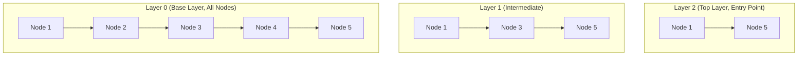

# GraphIndex Contract Specification

The `GraphIndex` contract (`khnsw.core.interfaces.GraphIndex`) specifies the interface that any pure or adapted Hierarchical Navigable Small World graph implementation must fulfill.

## Architectural Model
The graph is organized into $L + 1$ discrete layers indexed from $l = 0$ (dense base layer containing all nodes) up to $l = L$ (sparse top layer containing long-range links).

## Contract Invariants
1. **Layer Hierarchy**: If a node exists at level $l$, it must also exist at all levels $0 \le l' < l$.
2. **Degree Bounds**: For any node $v$ at level $l > 0$, out-degree $|N_l(v)| \le M$. For level 0, out-degree $|N_0(v)| \le M_0 = 2M$.
3. **Entry Point**: The entry point $ep$ must be a valid node present at the highest non-empty layer $L = \text{max\_level}()$.
4. **Reverse Edges**: In order to enable efficient kinetic updates, implementations must track incoming neighbors `in_neighbors(node_id, level)` such that $u \in \text{in\_neighbors}(v, l) \iff v \in \text{neighbors}(u, l)$.

## Operations
- `dim`: Dimensionality of vectors stored in the graph.
- `add(ids, vectors)`: Insert batches of vectors into the hierarchy.
- `move(node_id, new_vector)`: Update node spatial coordinates without immediately reconstructing the entire graph.
- `search(query, k, ef)`: Multi-layer greedy navigation followed by beam search at layer 0. Returns sorted top-$k$ IDs and distance metrics.
- `neighbors(node_id, level)`: Returns list of target IDs for outgoing edges at given layer.
- `in_neighbors(node_id, level)`: Returns incoming neighbor IDs for reverse-edge maintenance.
- `node_level(node_id)`: Maximum layer assigned to node.
- `max_level()`: Current top layer index.
- `entry_point()`: Identifier of top-layer root node.
- `vector(node_id)`: Current vector coordinates.
- `snapshot()`: Serializable dictionary representation for inspection, debugging, and visualization.

