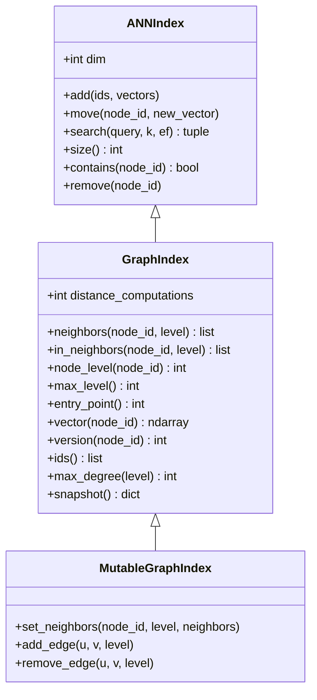
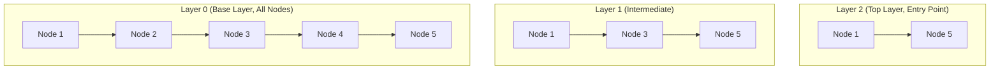

# GraphIndex Contract Specification

The index contracts specify the interfaces that any pure or adapted index implementations in K-HNSW must fulfill. The contracts are layered hierarchically:

## Architectural Model & Layer Hierarchy
The graph is organized into $L + 1$ discrete layers indexed from $l = 0$ (dense base layer containing all nodes) up to $l = L$ (sparse top layer containing long-range links).
An empty graph returns `max_level() == -1` and `entry_point() == None`.

## Distance Metric & Coordinate Contracts
- **Squared L2 Distance**: `search()` strictly computes and returns squared Euclidean distances ($\|q - v\|_2^2$).
- **Cosine Data**: Any dataset operating under cosine similarity or angular distance must be $\ell_2$-normalized prior to insertion and query (under unit normalization, $\|q - v\|_2^2 = 2 - 2 \langle q, v \rangle$).

## Lifecycle, Versioning, and Call Order
Under kinetic updates, components must follow a strict call sequence:
1. **Read Old Vector**: Query `v_old = index.vector(node_id)`.
2. **Move Node Coordinates**: Invoke `index.move(node_id, v_new)`. This updates the internal vector table and increments `version(node_id)` by 1.
3. **Notify Repairer**: Invoke `repairer.on_move(index, node_id, v_old, v_new, sink)` to trigger certificate evaluations and repair queuing.

## MutableGraphIndex Contract
`MutableGraphIndex` provides primitive mutation methods used by repair algorithms:
- `set_neighbors(node_id, level, neighbors)`: Atomically updates the forward neighbor list while updating reverse edge tables (`in_neighbors`) symmetrically for any added or severed links.
- `add_edge(u, v, level)`: Adds a directed edge $u \to v$ at layer $l$, ensuring $u \in \text{in\_neighbors}(v, l)$.
- `remove_edge(u, v, level)`: Removes directed edge $u \to v$ at layer $l$, ensuring $u \notin \text{in\_neighbors}(v, l)$.
- **Accounting**: Every mutation method must account for any pairwise distance calculations executed by incrementing `distance_computations`.

## Repair Budget & Invariants
- **Budget Unit**: Repair budgets allocated to `run_repairs(index, budget, sink)` are denominated strictly in **distance computations**.
- **Reachability Postcondition**: Reachability is **not** guaranteed to be preserved under arbitrary drift budgets; instead, reachability is **measured and reported** continuously as an evaluation metric.
